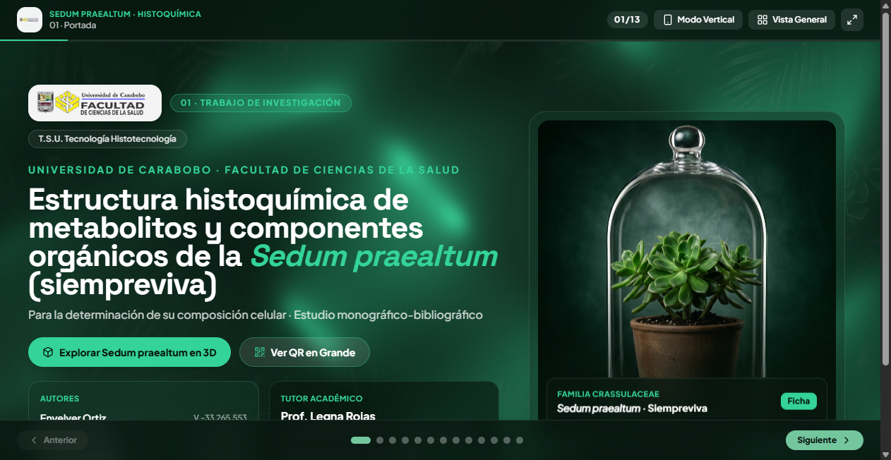

# Sedum praealtum (Siempreviva) — Presentación Histoquímica Interactiva

Presentación científica e interactiva para la defensa de trabajo de investigación de **T.S.U. en Tecnología Histotecnológica** de la **Universidad de Carabobo (Facultad de Ciencias de la Salud)**.



---

## 🌿 Características Principales

- **Diseño Luxury Botanical:** Paleta en verde bosque oscuro (`#091E15`), menta/esmeralda (`#34d399`) y tipografía sans moderna (*Plus Jakarta Sans* y *Space Grotesk*).
- **Modelo 3D Interactivo de *Sedum praealtum*:**
  - Órbita 360°, zoom e inspección con Three.js.
  - Simulaciones animadas de cuidados: **Riego** (gotas de agua y turgencia), **Luz Solar** (rayos volumétricos) y **Sustrato** (aireación y movimiento suave).
  - Puntos de interés anatómicos y modo pantalla completa.
- **Fondo WebGL Dinámico (ReactBits):** Gradiente orgánico de ondas suaves con parámetros personalizados.
- **Lámina con Código QR en Grande:** Para que estudiantes y profesores escaneen y abran la presentación directamente en sus dispositivos móviles.
- **Modo Responsive / Vertical:** Soporte para teléfonos móviles, tablets y pantallas de proyección.
- **13 Láminas Académicas Completas:** Introducción, objetivos, taxonomía, recolección botánica, fijación tisular, inclusión en parafina, microtomía, batería de coloraciones histoquímicas, metabolitos secundarios, cuidados y conclusiones.

---

## 🚀 Despliegue en Vercel (Paso a Paso)

1. Sube este repositorio a tu cuenta de **GitHub**.
2. Entra a [vercel.com](https://vercel.com) e inicia sesión con tu GitHub.
3. Haz clic en **"Add New Project"** e importa este repositorio.
4. Vercel detectará automáticamente la configuración (`npm run build` y directorio raíz `.`).
5. Haz clic en **"Deploy"** ¡y listo! Obtendrás tu enlace público `https://tu-proyecto.vercel.app`.

---

## 💻 Desarrollo Local

```bash
# Instalar dependencias
npm install

# Compilar los módulos
npm run build

# Iniciar servidor local en http://localhost:5173
npm run dev
```
